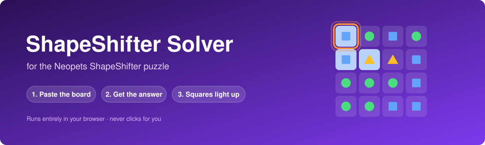
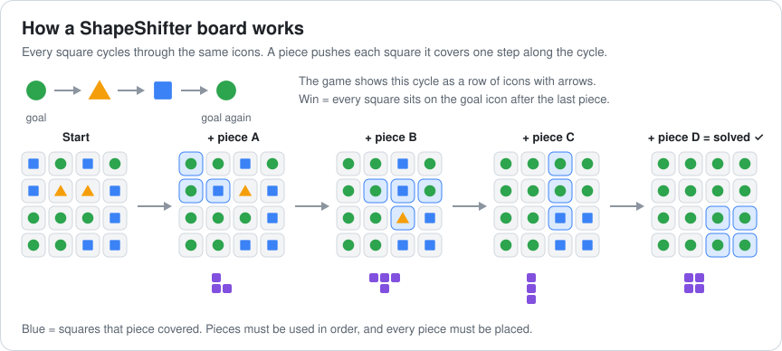
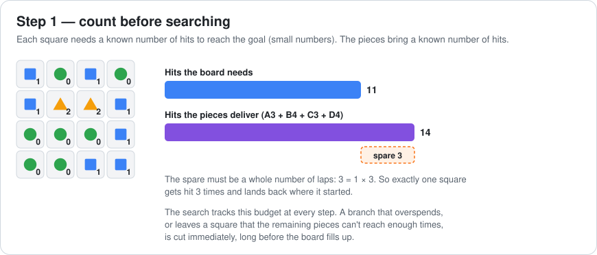
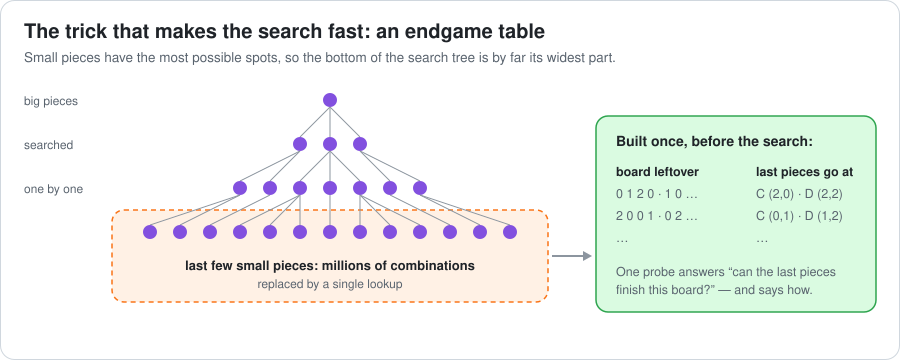
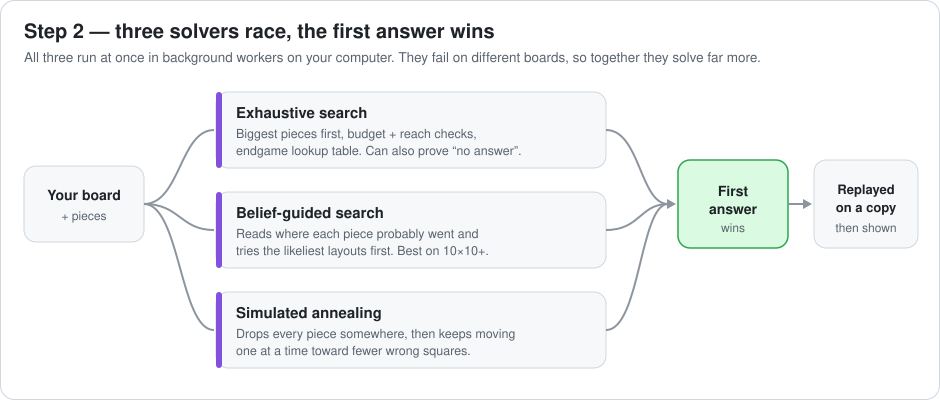
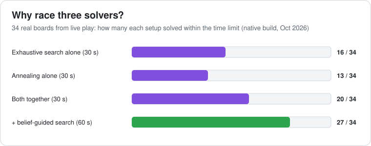
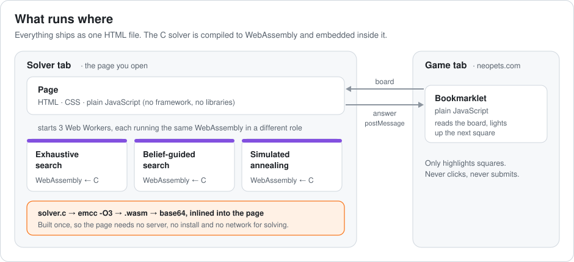

  

  

  <a href="#how-to-use">How to use</a>
  &nbsp;·&nbsp; <a href="#how-it-solves-a-board">How it works</a>
  &nbsp;·&nbsp; <a href="#how-its-built">How it's built</a>
  &nbsp;·&nbsp; <a href="#unlock">Unlock code</a>

---

**ShapeShifter Solver** works out the answer to a Neopets ShapeShifter board and shows you
where each piece goes. It's one web page. The solver runs on your own computer, so nothing
is uploaded.

<h3 align="center">✉️ Unlock code for level 40+ &nbsp;→&nbsp; <a href="mailto:gregoryfang89@gmail.com?subject=ShapeShifter%20Solver%20unlock%20code">gregoryfang89@gmail.com</a></h3>

 

<h1 align="center">⚙️ Under the hood</h1>

<i>How to use it · how it solves a board · how it's built</i>

---

## How to use

| | Step | What you do |
|:-:|---|---|
| **1** | **Copy the board** | Open the game from the solver page, press <kbd>Ctrl</kbd>+<kbd>A</kbd> then <kbd>Ctrl</kbd>+<kbd>C</kbd> (<kbd>⌘</kbd> on a Mac), come back and press <kbd>Ctrl</kbd>+<kbd>V</kbd>. |
| **2** | **Solve** | It starts by itself. Most boards take a second or two. Big late-game boards take longer. |
| **3** | **Place the pieces** | Follow the answer on the solver page, **or** drag the orange **Level N Solution** button to your bookmarks bar (favorites bar in Edge) and click it once in the game tab. The square to click then lights up after every piece. |

> The solver only highlights squares. It never clicks for you and never sends a score.

## How it solves a board

Once you see the rules as numbers, the puzzle turns into arithmetic. Each square needs a number
of hits, from 0 up to the cycle length − 1. Each piece adds one hit to every square it covers. A
square that gets a full lap of extra hits ends up where it started. So the goal is to place the
pieces so that, on every square, the total number of hits matches what that square needs
(counting in laps).

The order of the pieces doesn't change the final board, only where each one goes. That's what
lets the solver use the shortcuts below.

### 1 · Count before searching

Before trying any position, the solver knows how many "spare" hits the pieces bring. Every move
spends from that budget. It drops a branch straight away if:

- it spends more than the budget allows, or
- a square still needs *k* hits but fewer than *k* of the remaining pieces can reach it. This
  shows up most often in corners and along edges.

It places the largest pieces first because they use up the budget fastest and so rule out wrong
branches soonest. Identical pieces are only tried in one order, so the same layout isn't searched
twice.

### 2 · An endgame table for the widest part of the tree

Small pieces fit in the most places, so the last few levels of the search are where nearly all the
work is. Before searching, the solver lists every way the last few pieces can be placed. It
stores each one in a table, keyed by the board leftover it would fix. When the search gets down
to those pieces, one lookup tells it whether they can finish the board and where they go. This is
a partial *meet-in-the-middle*.

### 3 · Three solvers race

No single method wins on every board, so three run at once, each in its own background worker:

- **Exhaustive search**: everything above. It's the only one of the three that can also prove a
  board has *no* answer.
- **Belief-guided search**: the board is the sum of where the pieces went, so it can be read
  backwards. *Belief propagation* passes messages between pieces and squares to work out how
  likely each spot is for each piece. The search then tries the most likely layouts first.
  Along the true answer, the right spot is usually its first or second guess. After about 8
  pieces are down, it's nearly always right. This is the one that cracks the big 10×10 and
  11×10 boards.
- **Simulated annealing**: put every piece down at random, then keep moving one piece at a time
  toward fewer wrong squares. Now and then it accepts a worse move so it doesn't get stuck. It
  does best on boards with many answers, where exhaustive search can wander for a long time.

The first answer wins. Before you see it, the answer is replayed on a copy of the board to
confirm it actually clears it.

*Measured on 34 real boards with the native multi-threaded build. The browser page runs the same
three engines compiled to WebAssembly, so on a slower computer it may need more time on the
hardest boards.*

## How it's built

| Part | Language | Size |
|---|---|---|
| **Solver engine** — search, endgame table, belief propagation, annealing | **C** | ~1,300 lines |
| **Page** — paste reading, the three steps, answer view | **JavaScript**, no framework, no libraries | ~600 lines |
| **Board reader** — turns the copied game page into board, icon cycle and pieces | JavaScript | ~170 lines |
| **Show-on-board bookmark** | JavaScript bookmarklet | ~200 lines |
| **Unlock-code check** — Ed25519 signature, verified by the browser's built-in WebCrypto | JavaScript | ~70 lines |
| **Layout and styles** | HTML + CSS | ~240 lines |
| **Build** | Bash + Python | |
| **Tests** — headless Chromium against a fake local game page, never the real site | Python + Playwright | ~330 lines |

**From C to the browser.** The solver is written in C for speed and compiled to **WebAssembly**
with Emscripten (`emcc -O3`). The `.wasm` is base64-encoded and inlined into the page together
with all the JavaScript and CSS, so the whole thing is **one ~130 KB HTML file**: no server, no
CDN, nothing to install.

**Why three single-thread copies instead of one multi-threaded solver.** The native build uses a
thread pool, but shared-memory threads in a browser need special cross-origin isolation headers,
which GitHub Pages can't send and a page opened from disk can't get. So the page starts the same
single-thread WebAssembly in three Web Workers, and each copy takes one role: exhaustive search,
belief-guided search or annealing. That's the race in the diagram above. On a computer with fewer
than 3 cores it starts only the first two.

**Reading the board.** Everything comes from the HTML you paste: the board, the icon cycle, the
pieces and the level number are read straight from the game page's own markup, not from a
screenshot.

**The bookmark.** One click wraps the game in a full-page frame and talks to the solver tab with
`postMessage`. It sends the solver only the parsed board, never the page itself, so nothing from
your session leaves the game tab. It only highlights squares: it never clicks and never submits.
